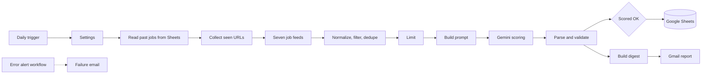

# AI Job Hunter Agent

An automated pipeline that collects entry-level jobs from seven free job feeds every morning, scores each one against my CV with Google Gemini, and emails me a report with skill gaps, CV tips and draft cover letters. It runs on a self-hosted n8n instance and uses only free tools.


## Latest run (4 October 2026)

| Jobs fetched | Scored by AI | Qualified (score 50+) | Highest match | Sources |
|---|---|---|---|---|
| 635 | 14 | 1 | 62% | 7 of 7 working |

Results change every day. The scoring is deliberately strict, so most listings do not qualify.


## The problem

Checking several job boards by hand every day is slow, and most listings are senior roles, off-topic, or restricted to candidates in other countries. This system does the searching and first-pass screening, so my time goes into applying.

## What it does

1. Runs every day at 8am.
2. Reads the jobs already saved in Google Sheets, so it never scores the same job twice.
3. Pulls jobs from seven public feeds.
4. Maps them to one schema, removes senior roles, off-topic roles and duplicates, and ranks entry-level roles first.
5. Scores the top candidates against my CV with Gemini, using a written rubric and schema-validated JSON output.
6. Saves every scored job to Google Sheets.
7. Emails a daily report with statistics, a ranked table, strengths, weaknesses, CV improvements, keywords, interview tips and a draft cover letter.
8. A separate workflow emails me if a run fails.


## Architecture



## Design decisions

- **One Settings node.** The CV, keywords, minimum score, limits, model and email all live in one place, so behaviour changes without touching logic.
- **Fault tolerance.** Every feed retries and is skipped if it fails, and the Gemini call retries with a delay. The report shows which sources failed and how many jobs could not be scored.
- **Filter before AI.** Free AI quotas are limited, so cheap keyword, seniority and remote filters run first and only the best candidates are scored.
- **Word-boundary keyword matching** so short keywords do not match inside unrelated words.
- **Structured AI output.** Gemini must return JSON that matches a schema. Scores are clamped to 0 to 100 and bad responses are counted as failures.
- **A rubric instead of "rate this job".** Skills overlap 40, seniority fit 25, location and work authorization 20, role relevance 15. Roles that require US, UK or EU work authorization are capped, because I apply from Nigeria.
- **Persistent duplicate check.** Past jobs are read from Google Sheets, so the check survives restarts and test runs.
- **Rate limiting.** AI requests are spaced out to stay inside the free tier.
- **Secrets stay out of the workflow.** The Gemini key is an n8n credential, never part of the exported file.
- **Sequential fetching.** Feeds are called one after another to keep memory use low on a modest laptop.

## Data sources

Listings come from the public feeds of [Remotive](https://remotive.com), [Remote OK](https://remoteok.com), [We Work Remotely](https://weworkremotely.com), [Himalayas](https://himalayas.app), [Jobicy](https://jobicy.com), [Working Nomads](https://www.workingnomads.com) and [Arbeitnow](https://www.arbeitnow.com). Each listing belongs to its source, and the report links back to the original posting. This project is for personal job hunting and does not republish listings.

## Repository structure

```
README.md
exports/
  ai-job-hunter-final.json        main workflow (CV removed)
  job-hunter-error-alert.json     failure alert workflow
screenshots/
docs/
  build-guide.md                  step-by-step build notes
```

## Run it yourself

You need n8n (self-hosted), a free Gemini API key, and your own Google credentials for Sheets and Gmail. Import the files in `exports`, add a Header Auth credential named `x-goog-api-key` for Gemini, paste your own CV into the Settings node, and add the column headers listed in the build guide to your Sheet. Never commit credentials or personal data.

## Tech stack

n8n (self-hosted), JavaScript, REST APIs, RSS, Google Gemini (structured output), Google Sheets API, Gmail API.

## Limitations and roadmap

- Runs only while n8n is running on the host machine.
- Free job feeds are mostly aimed at developers with experience, so qualified matches are rare for entry-level profiles.
- Feeds can change their fields, so a source can stop working.
- Planned: a Looker Studio dashboard (jobs found, applied, interviews, offers), a fallback model when Gemini is overloaded, and more sources.

## About this project

Built with AI assistance. I configured, tested and debugged it, including API rate limits, 503 errors, duplicate detection and credential setup, and I can walk through every node.

## Author

Jude Ughakpoteni, Electrical/Electronics Engineering graduate, building AI automations with n8n. Based in Benin City, Nigeria.
LinkedIn: https://linkedin.com/in/jude-ughakpoteni-337393413
